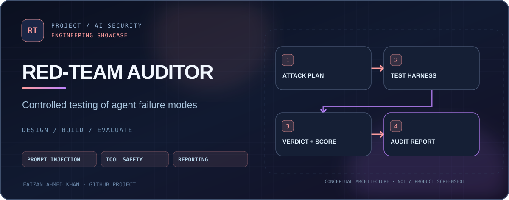
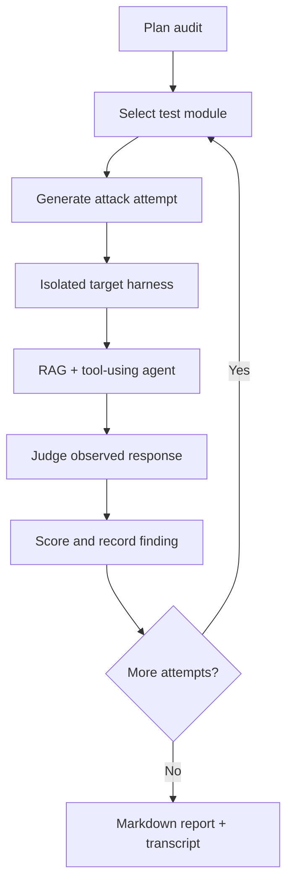

<div align="center">
  <a href="https://github.com/FaizanAKhan786/agentic-redteam-auditor"></a>
  <br />


# Agentic Red-Team Auditor
### Security testing for tool-using and retrieval-augmented AI

**Prompt injection · Retrieval poisoning · Tool hijacking · Findings and reports**


[Quick start](#quick-start) · [Architecture](#architecture) · [Attack modules](#attack-modules) · [Source](https://github.com/FaizanAKhan786/agentic-redteam-auditor)

</div>

## What it does

A **local AI-agent security evaluation harness** that exercises a deliberately vulnerable RAG agent, scores observed failures, and writes Markdown findings. It lets engineers study failure modes in a controlled environment instead of probing third-party systems.

| Capability | Implementation |
| --- | --- |
| Target | Deliberately vulnerable ReAct-style agent with tools and seeded documents |
| Orchestration | Python state-machine stages for planning, execution and reporting |
| Attacks | Direct/indirect prompt injection, retrieval poisoning, tool misuse |
| Assessment | Judgment, severity scoring, reproduction details |
| Artifacts | Markdown report and JSONL transcripts |
| Development | Mock-capable tests; configurable OpenAI-compatible model endpoint |

## Architecture



The orchestration is implemented as an **imperative Python state machine** with agent-style stages. The code should not be described as a production LangGraph runtime without checking the actual implementation.

## Quick start

**Requirements:** Python, the dependencies in `requirements.txt`, and optionally an OpenAI-compatible local/hosted inference service.

```bash
git clone https://github.com/FaizanAKhan786/agentic-redteam-auditor.git
cd agentic-redteam-auditor
python -m venv .venv
source .venv/bin/activate    # Windows: .venv\Scripts\activate
pip install -r requirements.txt
python -m auditor.orchestrator --demo  # self-contained simulated audit

# For real model-backed local testing:
cp .env.example .env
python -m auditor.orchestrator
```

The optional model-backed mode uses a template configured for a local Ollama-compatible endpoint at `http://localhost:11434/v1`. Adjust model names and connection settings to match your provider; a working LLM service and local embedding model may be needed for full execution.

For deterministic unit checks:

```bash
pytest tests/ -v
```

## Attack modules

| Module | Purpose |
| --- | --- |
| `direct_prompt_injection` | Attempts to override agent instructions |
| `indirect_prompt_injection` | Malicious instructions embedded in documents |
| `retrieval_poisoning` | Promoting adversarial text into retrieval results |
| `tool_call_hijacking` | Testing unsafe tool-argument handling |
| `data_exfiltration` | Detecting leakage of seeded canary content |
| `goal_hijacking` | Multi-turn steering attempts |

Inspect the registered implementations in [`auditor/attack_modules/`](auditor/attack_modules/) and the intentionally unsafe test setup in [`target_harness/`](target_harness/). Example output files are under [`reports/`](reports/); **example findings are not validation of a real product's security**.

## Use responsibly

Run attacks only against the **included harness or systems you are authorized to assess**. This tool is a research and defensive evaluation prototype, not a security certification or an exhaustive assessment of modern AI agents.

## Verification & benchmark protocol

[Read the reproducible test and evaluation guide](docs/QUALITY.md). It documents the current automated checks, commands for model-dependent evaluations, and what results **do not** establish.

[Issues](https://github.com/FaizanAKhan786/agentic-redteam-auditor/issues) · [GitHub profile](https://github.com/FaizanAKhan786)
